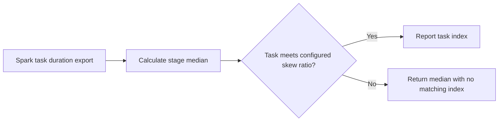

# ADB Spark Performance Agent

A small number of slow Spark tasks can delay a stage even when its average runtime looks acceptable.

## What I built

I built a Spark task-skew diagnostic that calculates the stage median and flags task indexes at or above the configured multiple. The relative threshold makes the check usable across stages with different baseline runtimes.

## How it works



[Architecture](docs/ARCHITECTURE.md) · [Decision rules and source](docs/RULES.md)

## Tools used

| Tool | Role in this repository |
| --- | --- |
| Python | [agent.py](agent.py) implements the CLI and decision rules. Uses `argparse` to parse command-line options, `json` to read or write structured records, `pathlib` to read local files, `statistics` to calculate a median baseline. |
| Make | Runs the documented example and local checks. |
| Python replay runner | Compares actual stdout with the checked-in baseline fixtures. |
| Ruff and Bandit | Developer lint and static security checks through `make check`. |

## Run the project

Use Python 3.10+ and Make. From the repository root:

```sh
python3 agent.py example.json
```

The sample median is 105 ms. Task index 3 meets the skew threshold. [Full expected output](examples/Bundled%20scenario.stdout.txt)

### Additional replay cases

- **Regression scenario** · `python3 agent.py examples/regression.json` · [Expected output](examples/Regression%20scenario.stdout.txt)

## Verify the project

```sh
make verify
make replay
```

`make replay` checks the recorded cases and exits nonzero if the output changes.
See the [developer guide](docs/DEVELOPMENT.md) for the pinned lint and security tools.

## Operating limits

The supplied durations represent one stage. Inspect partition size, executor metrics, and shuffle data before assigning a cause. The tool reads an export and does not connect to a cluster.

[Case study](docs/CASE_STUDY.md) · [Operator runbook](docs/RUNBOOK.md) · [Verification report](reports/verification.md)
