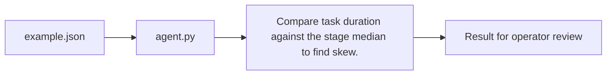

# Adb Spark Performance Agent architecture

Find a skewed Spark task from stage timing summaries.

## Operational boundaries

The documented run evaluates the bundled sample locally. Results depend on the quality and scope of the input. The demo makes no live infrastructure changes.
